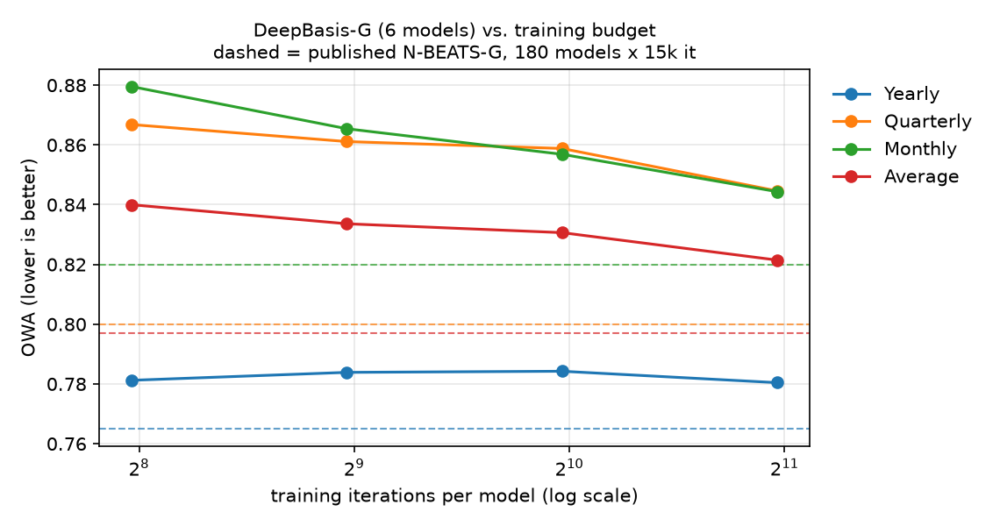
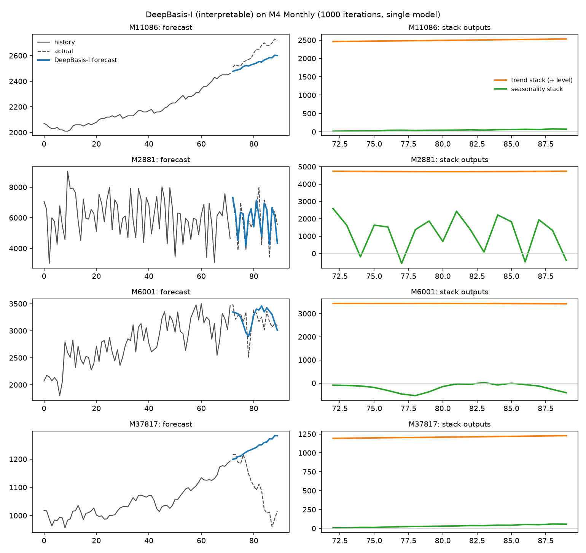
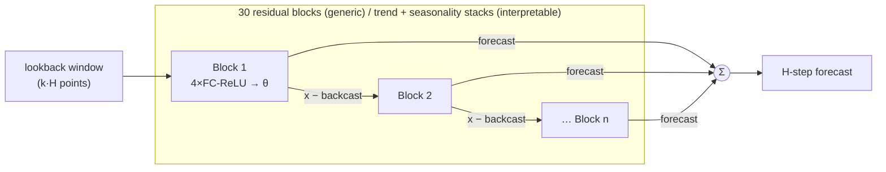

# DeepBasis: Interpretable Neural Forecasting on 100,000 Time Series

[](../../actions/workflows/ci.yml)

DeepBasis is a deep-learning forecasting system evaluated on all **100,000 real-world series of the M4 forecasting competition**. The series cover yearly to hourly data from finance, industry, demographics and macro-economics. It is a pure deep-learning model: no hand-made features and no per-series statistical models. It is fast to train, its forecasts can be split into readable trend and seasonality parts, and it is evaluated exactly the way the competition scored its entries.

The architecture is the residual basis-expansion network **N-BEATS** (Oreshkin et al., ICLR 2020). DeepBasis implements it from scratch in PyTorch, together with its own training, ensembling and evaluation pipeline.

## Headline results (official M4 test set, 100k series)

| Model | sMAPE ↓ | OWA ↓ | Compute |
|---|---:|---:|---|
| Naive2 (competition reference) | 13.564 | 1.000 | — |
| Theta (best simple M4 benchmark) | 12.311 | 0.898 | seconds |
| M4 competition winner, Smyl (published) | 11.374 | 0.821 | — |
| **DeepBasis-G, 6-model ensemble** | **11.491** | **0.821** | **3.6 h on a laptop (Apple M1, 8 GB)** |
| N-BEATS-G, 180-model ensemble (published) | 11.168 | 0.797 | about 200× more model-iterations |

- **It matches the M4 winner's OWA (0.821)** with a 6-model ensemble trained in 3.6 hours on a laptop.
- **It beats Theta by 8.6% OWA and 6.7% sMAPE.**
- **It keeps 88% of the published accuracy gain over Naive2 at 0.5% of the compute:** 54k model-iterations, against 10.8M for the published 180-model ensemble.
- **Ensembling** across 3 losses and 2 lookback lengths cuts sMAPE by 3.4% compared with the average single model.

Full tables, broken down by frequency, training budget, loss and lookback: [results/RESULTS.md](results/RESULTS.md).

<p align="center"></p>

### Interpretable forecasts

The interpretable variant (DeepBasis-I) constrains one stack to low-order polynomials (trend) and one to Fourier terms (seasonality), so each forecast splits into readable parts. A single DeepBasis-I model reaches sMAPE 12.30 on Monthly, on par with the 6-model generic ensemble. The bottom example is a deliberate failure case: a trend reversal the model could not anticipate.

<p align="center"></p>

## How it works



- **Model** (`deepbasis/model.py`). Each block maps the window to expansion coefficients θ and projects them onto a backcast basis and a forecast basis. The generic model uses learned linear bases (30 blocks, about 25M parameters). The interpretable model uses polynomial and Fourier bases, with weights shared within each stack.
- **Training** (`deepbasis/sampler.py`, `deepbasis/train.py`). Each batch takes 1,024 windows sampled from the recent history of random series, with zero-padding plus masks for short series. Adam with step decay and gradient clipping, on the Apple MPS GPU.
- **Scale-free losses** (`deepbasis/losses.py`). sMAPE, MAPE and MASE. One model makes predictions for series whose scales range over 6 orders of magnitude, with no normalisation step.
- **Ensemble.** Median over models trained with different losses and lookbacks (3H and 5H).
- **Evaluation** (`deepbasis/metrics.py`, `deepbasis/naive2.py`). The official M4 sMAPE, MASE and OWA. The Naive2 reference implementation reproduces the official competition values **exactly (12 of 12 numbers)**, which validates the whole scoring pipeline.
- **Baselines** (`deepbasis/baselines.py`). Theta and SES via statsforecast, both within 0.05 sMAPE of the official M4 benchmark scores.

Design decisions and the scaled training budget are documented in [docs/IMPLEMENTATION_NOTES.md](docs/IMPLEMENTATION_NOTES.md).

## Quickstart

```bash
python -m venv .venv && source .venv/bin/activate
make install            # package + dev tools + statsforecast
make data               # download M4 (~250 MB)
make baselines          # Theta / SES (~10 min)
make train-laptop       # 36 runs, ~3.6 h on an M1; resumable, skips finished runs
make evaluate           # results/RESULTS.md, results/results.json, budget plot
make figures            # trend/seasonality decomposition plot
make test lint
```

A single run: `deepbasis train --freq Monthly --arch interpretable --loss mase --lookback 5 --iterations 1000`.
The full published protocol (180 models per frequency): `make train-paper`. This needs a GPU cluster.

## Engineering notes

- **Profiling.** On Apple MPS, a masked loss written with boolean indexing forced a device sync on every step. Rewriting it with `torch.where` cut step time by about 23% (268 → 206 ms). fp16 autocast gave no speed-up and destabilised the sMAPE loss, so training stays in fp32.
- **Checkpointed forecasts.** Every run saves test forecasts at 250, 500, 1000 and 2000 iterations. The accuracy-vs-budget curve therefore comes from the same runs, not separate experiments.
- **Reproducibility.** Seeds are fixed, each saved forecast has a JSON file with its config, run time and device, and the results tables are generated from saved forecasts by `deepbasis evaluate`.
- **Tests.** 24 unit tests cover metric edge cases, the Naive2 seasonality test, basis functions, weight sharing, masking and decomposition consistency. CI runs ruff and pytest on every push.

## Repository layout

```
deepbasis/      model, losses, sampler, training, metrics, Naive2, baselines, report, CLI
scripts/        decomposition figure, sanity check
tests/          unit tests (no dataset needed)
results/        RESULTS.md, results.json, figures, per-run metadata
docs/           implementation notes
```

## Reference

Oreshkin, B. N., Carpov, D., Chapados, N., & Bengio, Y. (2020). *N-BEATS: Neural basis expansion analysis for interpretable time series forecasting.* ICLR. [arXiv:1905.10437](https://arxiv.org/abs/1905.10437)

Makridakis, S., Spiliotis, E., & Assimakopoulos, V. (2020). *The M4 Competition: 100,000 time series and 61 forecasting methods.* International Journal of Forecasting, 36(1).

## License

MIT
